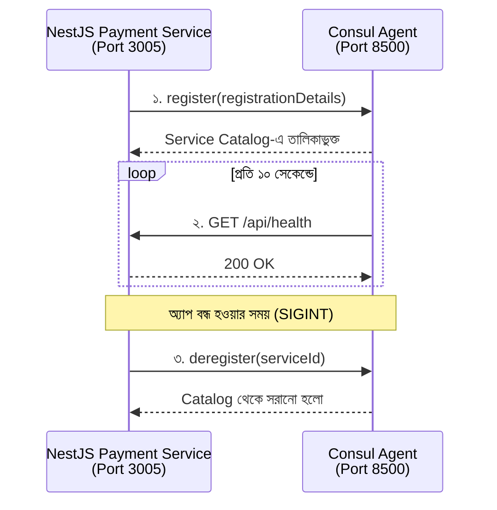

# NestJS-এ Consul Service Registration — লাইন বাই লাইন ব্যাখ্যা

> `payment-service`-কে Consul-এ রেজিস্টার করা, Health Check সেটআপ এবং Graceful Deregistration — সহজ বাংলায়।

---

## 📑 সূচিপত্র

1. [Consul ইমপোর্ট](#১-import-consul-from-consul)
2. [পোর্ট নির্ধারণ](#২-const-port--3005)
3. [Consul-এর সঙ্গে সংযোগ](#৩-consul-এর-সঙ্গে-সংযোগ-স্থাপন)
4. [serviceId](#৪-serviceid-কী)
5. [registrationDetails](#৫-registrationdetails-কী)
6. [সার্ভিস রেজিস্টার](#৬-consul-এ-সার্ভিস-রেজিস্টার-করা)
7. [SIGINT Event](#৭-sigint-event-কী)
8. [app.listen() ও console.log()](#৮-applisten-এবং-consolelog)
9. [পুরো প্রক্রিয়া এক নজরে](#-পুরো-প্রক্রিয়াটি-এক-নজরে)
10. [সম্পূর্ণ কোড](#-সম্পূর্ণ-কোড-একসঙ্গে)
11. [Production Checklist](#-production-checklist)

---

## ১. `import Consul from 'consul';`

```ts
import Consul from 'consul';
```

**কাজ:** `consul` npm package থেকে `Consul` ক্লাসটি ইমপোর্ট করা হচ্ছে।

এর মাধ্যমে NestJS অ্যাপ্লিকেশন থেকে Consul-এর সঙ্গে যোগাযোগ করা যায়:

| ক্ষমতা | বিবরণ |
| --- | --- |
| **Service Registration** | সার্ভিসকে Consul-এ নিবন্ধন করা |
| **Service Discovery** | অন্য সার্ভিসের ঠিকানা খুঁজে বের করা |
| **Health Check** | সার্ভিস সচল আছে কি না যাচাই করা |
| **Service Deregistration** | Consul থেকে সার্ভিসের নিবন্ধন সরিয়ে ফেলা |

> 💡 সহজভাবে, `Consul` হলো NestJS অ্যাপ্লিকেশন এবং Consul-এর মধ্যে যোগাযোগের মাধ্যম।

---

## ২. `const port = 3005;`

```ts
const port = 3005;
```

**কাজ:** `payment-service` কোন পোর্টে চলবে, সেটি নির্ধারণ করা হচ্ছে।

পরে এই কোড চালু হলে:

```ts
await app.listen(port);
```

NestJS অ্যাপ্লিকেশনটি `3005` পোর্টে HTTP request গ্রহণ করবে।

**উদাহরণ:** `http://localhost:3005`

---

## ৩. Consul-এর সঙ্গে সংযোগ স্থাপন

```ts
const consul = new Consul({
  host: 'localhost',
  port: 8500,
});
```

`Consul` অবজেক্ট তৈরি করা হচ্ছে, যাতে NestJS অ্যাপ্লিকেশন Consul Agent-এর সঙ্গে যোগাযোগ করতে পারে।

| কোড | কাজ |
| --- | --- |
| `host: 'localhost'` | Consul কোথায় চলছে, সেটি নির্দেশ করে |
| `port: 8500` | Consul-এর HTTP API পোর্ট (ডিফল্ট `8500`) |

**উদাহরণ:** Docker-এ Consul চালু থাকলে এবং `8500` পোর্ট প্রকাশ করা থাকলে, `localhost:8500` দিয়ে তার API-তে যোগাযোগ করা যায়।

> ⚠️ **মনে রাখবে:** এখানে `localhost` বলতে NestJS যে পরিবেশে চলছে, সেই পরিবেশের localhost বোঝায়। NestJS নিজেও Docker container-এর ভেতরে চললে কনফিগারেশন আলাদা হতে পারে।

---

## ৪. `serviceId` কী?

```ts
const serviceId = 'payment-unique-id-1';
```

**কাজ:** Payment Service-এর জন্য একটি ইউনিক পরিচয় (ID) নির্ধারণ করা।

ধরো, দুটি Payment Service instance চলছে:

```
payment-unique-id-1
payment-unique-id-2
```

নাম একই হতে পারে, কিন্তু ID আলাদা থাকবে।

| Property | কী চিহ্নিত করে |
| --- | --- |
| `name` | সার্ভিসের **ধরন / নাম** |
| `id` | নির্দিষ্ট একটি **instance** |

এটি পরে নির্দিষ্ট instance-টিকে Consul থেকে deregister করার কাজেও লাগে।

---

## ৫. `registrationDetails` কী?

```ts
const registrationDetails = {
  name: 'payment-service',
  address: 'host.docker.internal',
  port: port,
  id: serviceId,
  check: {
    name: 'payment-service-health',
    http: `http://host.docker.internal:${port}/api/health`,
    interval: '10s',
    timeout: '5s',
  },
};
```

এটি একটি JavaScript object, যেখানে Consul-কে জানানো হচ্ছে **কোন সার্ভিস** রেজিস্টার হবে, **কোথায়** পাওয়া যাবে এবং **কীভাবে** তার স্বাস্থ্য পরীক্ষা হবে।

### 🔹 প্রতিটি property-র কাজ

| Property | ব্যাখ্যা |
| --- | --- |
| `name: 'payment-service'` | Consul-এ সার্ভিসের নাম। অন্য সার্ভিস এই নাম দিয়েই Payment Service খুঁজবে |
| `address: 'host.docker.internal'` | সার্ভিস কোন ঠিকানায় পৌঁছানো যাবে। Docker Desktop-এ container থেকে host machine-এর সার্ভিসে পৌঁছাতে সাধারণত এটি ব্যবহার হয় |
| `port: port` | `port` ভেরিয়েবলের মান, অর্থাৎ `3005` |
| `id: serviceId` | নির্দিষ্ট instance-এর পরিচয়, এখানে `payment-unique-id-1` |

### 🔹 Health Check অংশ

```ts
check: {
  name: 'payment-service-health',
  http: `http://host.docker.internal:${port}/api/health`,
  interval: '10s',
  timeout: '5s',
}
```

| Property | ব্যাখ্যা |
| --- | --- |
| `name` | Health Check-এর নাম |
| `http` | যে HTTP endpoint-এ Consul request পাঠাবে |
| `interval: '10s'` | প্রতি **১০ সেকেন্ডে** Health Check |
| `timeout: '5s'` | **৫ সেকেন্ডে** উত্তর না এলে Check ব্যর্থ ধরা হবে |

Health Check URL হবে:

```
http://host.docker.internal:3005/api/health
```

এই endpoint NestJS অ্যাপে **অবশ্যই তৈরি থাকতে হবে** এবং সুস্থ অবস্থায় সফল HTTP response দিতে হবে, যেমন `200 OK`:

```json
{
  "status": "ok"
}
```

> 📌 শুধু JSON-এর `status` দেখে Consul সিদ্ধান্ত নেয় না। সাধারণ HTTP Health Check-এ **সফল HTTP status code** পাওয়াই গুরুত্বপূর্ণ।

---

## ৬. Consul-এ সার্ভিস রেজিস্টার করা

```ts
await consul.agent.service.register(registrationDetails);
```

**কাজ:** `registrationDetails`-এর তথ্য ব্যবহার করে Consul Agent-এর কাছে Payment Service রেজিস্টার করা।

| অংশ | অর্থ |
| --- | --- |
| `consul.agent.service.register()` | সার্ভিস নিবন্ধনের মেথড |
| `registrationDetails` | নাম, ঠিকানা, পোর্ট, ID ও Health Check-এর তথ্য |
| `await` | রেজিস্ট্রেশন শেষ হওয়া পর্যন্ত অপেক্ষা করে |

রেজিস্ট্রেশন সফল হলে Consul সার্ভিসটিকে তার **Service Catalog**-এ তালিকাভুক্ত করে।

> ⚠️ রেজিস্টার হওয়া মানেই সার্ভিস **Healthy** হওয়া নয়। Health Check আলাদাভাবে সার্ভিসের অবস্থা যাচাই করে।

---

## ৭. `SIGINT` Event কী?

```ts
process.on('SIGINT', async () => {
  await consul.agent.service.deregister(serviceId);
  process.exit();
});
```

এই অংশটি অ্যাপ্লিকেশন **বন্ধ করার সময়** কাজ করে।

| লাইন | কাজ |
| --- | --- |
| `process.on('SIGINT', ...)` | `SIGINT` সিগন্যাল এলে callback চলবে। টার্মিনালে `Ctrl + C` চাপলে এই সিগন্যাল আসে |
| `await consul.agent.service.deregister(serviceId)` | `payment-unique-id-1` ID-র সার্ভিসটি Consul-এর Service Catalog থেকে সরানোর চেষ্টা করে |
| `process.exit()` | Node.js process বন্ধ করে দেয় |

**কেন গুরুত্বপূর্ণ?** অ্যাপ বন্ধ হওয়ার পরও Consul-এ পুরোনো রেজিস্ট্রেশন থেকে গেলে Service Discovery-তে সমস্যা হতে পারে।

> 🛡️ **Production-level টিপ:**
> - `SIGTERM`-ও handle করো (Docker/Kubernetes stop করার সময় এটিই আসে)।
> - Deregistration ব্যর্থ হলে error handling রাখো।
> - `process.exit()`-এর আগে NestJS অ্যাপ graceful shutdown করো।

---

## ৮. `app.listen()` এবং `console.log()`

```ts
await app.listen(port);

console.log(
  `Payment service is running on port ${port} and registered in Consul with ID: ${serviceId}`,
);
```

| লাইন | কাজ |
| --- | --- |
| `await app.listen(port)` | NestJS সার্ভারকে `3005` পোর্টে চালু করে |
| `console.log(...)` | টার্মিনালে বার্তা দেখায় |

আউটপুট:

```
Payment service is running on port 3005 and registered in Consul with ID: payment-unique-id-1
```

> ⚠️ এই বার্তা শুধু কোডের execution অবস্থার ওপর ভিত্তি করে দেখানো হয়। `app.listen()`-এর পরে error handling না থাকলে এটি Health Check সফল হওয়ার **নিশ্চয়তা দেয় না**।

---

## 🔄 পুরো প্রক্রিয়াটি এক নজরে



**ASCII রূপ (Mermaid সাপোর্ট না থাকলে):**

```
┌──────────────────────────┐        ┌───────────────────┐
│ NestJS Payment Service   │        │   Consul Agent    │
│ Port: 3005               │        │   Port: 8500      │
└────────────┬─────────────┘        └─────────┬─────────┘
             │  1. Service Registration       │
             │ ─────────────────────────────▶ │
             │                                │
             │  2. Health Check (প্রতি ১০s)   │
             │ ◀───── GET /api/health ─────── │
             │ ────────── 200 OK ───────────▶ │
             │                                │
             │  3. Deregister (SIGINT-এ)      │
             │ ─────────────────────────────▶ │
```

> **সংক্ষেপে:** Payment Service-কে Consul-এ নিবন্ধন করা, তার ঠিকানা প্রকাশ করা এবং নিয়মিত Health Check-এর মাধ্যমে অবস্থা যাচাই করাই এই কোডের মূল উদ্দেশ্য।

---

## 🧩 সম্পূর্ণ কোড একসঙ্গে

> উপরের অংশগুলো একসঙ্গে জুড়ে দেওয়া হলো। `NestFactory.create` অংশটি রেফারেন্সের জন্য যোগ করা, তোমার প্রজেক্টের `AppModule` অনুযায়ী মিলিয়ে নিও।

```ts
import { NestFactory } from '@nestjs/core';
import Consul from 'consul';
import { AppModule } from './app.module';

async function bootstrap() {
  const app = await NestFactory.create(AppModule);

  const port = 3005;

  // Consul Agent-এর সঙ্গে সংযোগ
  const consul = new Consul({
    host: 'localhost',
    port: 8500,
  });

  // নির্দিষ্ট instance-এর ইউনিক ID
  const serviceId = 'payment-unique-id-1';

  // Consul-কে যা জানানো হবে
  const registrationDetails = {
    name: 'payment-service',
    address: 'host.docker.internal',
    port: port,
    id: serviceId,
    check: {
      name: 'payment-service-health',
      http: `http://host.docker.internal:${port}/api/health`,
      interval: '10s',
      timeout: '5s',
    },
  };

  // সার্ভিস রেজিস্টার
  await consul.agent.service.register(registrationDetails);

  // বন্ধ হওয়ার সময় deregister
  process.on('SIGINT', async () => {
    await consul.agent.service.deregister(serviceId);
    process.exit();
  });

  await app.listen(port);

  console.log(
    `Payment service is running on port ${port} and registered in Consul with ID: ${serviceId}`,
  );
}

bootstrap();
```

---

## ✅ Production Checklist

- [ ] `/api/health` endpoint তৈরি আছে এবং `200 OK` দেয়
- [ ] `SIGTERM` handle করা হয়েছে (শুধু `SIGINT` নয়)
- [ ] Deregistration-এ `try/catch` আছে
- [ ] `process.exit()`-এর আগে `app.close()` দিয়ে graceful shutdown
- [ ] `host`, `port`, `serviceId` hard-code না করে environment variable থেকে নেওয়া
- [ ] একাধিক instance চালাতে `serviceId` ডাইনামিক (যেমন hostname/UUID সহ)
- [ ] Docker-এ চললে `localhost` / `host.docker.internal` ঠিকমতো কনফিগার করা
